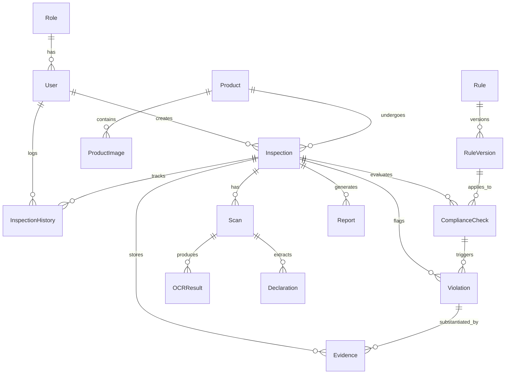

# MetaCheck AI — AI-Powered Legal Metrology Compliance & Inspection System

[](https://fastapi.tiangolo.com)
[](https://www.sqlalchemy.org)
[](https://alembic.sqlalchemy.org)
[](https://reactjs.org)
[](https://www.typescriptlang.org)
[](https://www.postgresql.org)
[](https://www.docker.com)

> **Statutory Notice**: MetaCheck AI provides **AI-assisted screening** tools for Legal Metrology enforcement and compliance monitoring. Output findings indicate *"Potential non-compliance detected"* and require final *"Manual verification"* by authorized Legal Metrology Officers (LMOs).

---

## 1. What is MetaCheck AI?

**MetaCheck AI** is a web-based, AI-assisted compliance inspection and screening platform designed to verify packaged commodities against statutory Indian Legal Metrology regulations—specifically **The Legal Metrology Act, 2009** and **The Legal Metrology (Packaged Commodities) Rules, 2011 (PCR, 2011)**.

### The Problem It Solves
1. **Manual Inspection Bottlenecks**: Millions of packaged commodities across brick-and-mortar retail and e-commerce platforms must adhere to mandatory label declarations. Field officers face overwhelming manual verification volumes.
2. **Statutory Non-Compliance Risk**: Missing mandatory declarations (e.g., Manufacturer address, Net Quantity font ratios, Month & Year of packing, Unit Sale Price (USP), Country of Origin, Consumer Care details) lead to consumer deception and statutory penalties.
3. **Audit Trails & Evidence Traceability**: Field officers require tamper-resistant, structured digital audit trails, standardized reporting dossiers, and rapid non-compliance tracking.

---

## 2. Technology Stack

### Frontend
- **Framework**: React 18+ with TypeScript
- **Build Tool**: Vite
- **Styling**: Tailwind CSS (with custom Metrology compliance color tokens and glassmorphism)
- **Routing**: React Router v6
- **Data Visualization**: Recharts
- **Icons**: Lucide React
- **HTTP Client**: Axios
- **Testing**: Vitest + React Testing Library + JSDOM

### Backend
- **Framework**: FastAPI (Python 3.11 / Python 3.9+)
- **Data Validation & Settings**: Pydantic v2 & Pydantic-Settings
- **ORM & DB Abstraction**: SQLAlchemy 2.0 (Async/Sync)
- **Database Migrations**: Alembic
- **Testing**: Pytest + pytest-asyncio + aiosqlite + HTTPX

### Database & Storage
- **Relational Database**: PostgreSQL 16
- **Drivers**: `asyncpg` (FastAPI async runtime) & `psycopg2-binary` (sync migrations)

### Infrastructure & DevOps
- **Containerization**: Docker & Multi-stage Dockerfiles
- **Orchestration**: Docker Compose
- **Configuration**: Strict `.env.example` templates

---

## 3. Database Architecture (15 Core Entities)



1. `roles` — RBAC roles (`ADMIN`, `ENFORCEMENT_OFFICER`, `VIEWER`).
2. `users` — Officer and analyst accounts (password hashes safely excluded from APIs).
3. `products` — Packaged commodity master records (Brand, Category, Barcode/GTIN).
4. `product_images` — Package panel photography references.
5. `inspections` — **Central workflow entity** tracking field and portal inspection workflows.
6. `scans` — Image processing execution instances.
7. `ocr_results` — Multi-engine OCR text outputs with bounding boxes.
8. `declarations` — Extracted package declaration entities.
9. `rules` — Authoritative statutory rules grounded in official PCR 2011 clauses.
10. `rule_versions` — Gazette-grounded temporal versioning.
11. `compliance_checks` — Automated rule screening evaluations (`PASS`, `FAIL`, `REVIEW`, `NOT_APPLICABLE`).
12. `violations` — Flagged potential non-compliances for officer physical verification.
13. `evidences` — Cropped label images, spatial coordinates, and audit tokens.
14. `reports` — AI-assisted advisory inspection reports (PDF, JSON, CSV).
15. `inspection_histories` — Immutable audit trail of every status transition.

---

## 4. Configuration: Production vs. SIH Demo Environment

To ensure data integrity and prevent accidental synthetic seeding in production:

| Environment | Variable Configuration | Seeder Behavior |
| :--- | :--- | :--- |
| **Production (Default)** | `DEMO_DATA_ENABLED=false`<br>`DEMO_SEED_ENABLED=false` | Demo endpoints return `403 Forbidden`. No automatic synthetic seeding. |
| **SIH Demo / Evaluation** | `DEMO_DATA_ENABLED=true`<br>`DEMO_SEED_ENABLED=true` | Enables controlled demonstration scenario loading and sample seeding. |

---

## 5. OCR Engine Architecture & Performance Claims

MetaCheck AI implements a modular multi-engine OCR provider architecture:

| OCR Engine | Execution Context | Typical Latency Range | Environment Availability |
| :--- | :--- | :--- | :--- |
| **Mock OCR** | In-memory deterministic simulator (for CI/CD unit testing) | ~5 – 15 ms | Always available |
| **Tesseract OCR** | CPU binary via `pytesseract` | ~350 – 800 ms | Available when `tesseract` binary is installed |
| **PaddleOCR** | Deep learning model (PP-OCRv4) | ~800 – 1800 ms | Available when `paddleocr` & weights are installed |

> [!IMPORTANT]
> **Performance Integrity Notice**: Mock OCR latency reflects in-memory dictionary lookup and test execution speed, **not** real-world deep-learning OCR throughput. If external OCR C++ libraries are not present in the deployment environment, the system displays: *"Real OCR engine benchmark not available in this environment."*

---

## 6. Authentication, RBAC & Seed Accounts

MetaCheck AI features production JWT-based authentication (`bcrypt` password hashing, token revocation, RBAC route guards):

### Built-in Seed Roles & Credentials

| Role | Email | Password | Permissions & Modules |
| :--- | :--- | :--- | :--- |
| **`ADMIN`** | `admin@metacheck.gov.in` | `Admin@123` | Full access (Dashboard, Scanner, History, Repository, Violations, Reports, Rule Management & Publishing, User Management, Settings) |
| **`ENFORCEMENT_OFFICER`** | `officer@metacheck.gov.in` | `Officer@123` | Operational access (Dashboard, Scanner, Scan Result, History, Repository, Violations Review, Report Generation) |
| **`VIEWER`** | `viewer@metacheck.gov.in` | `Viewer@123` | Read-only audit access (Dashboard, History, Product Repository, Download Reports) |

---

## 7. Security Hardening & Safe Architecture

- **Anti-IDOR & Path Traversal**: Files are hashed and stored using deterministic internal UUIDs rather than user-supplied filenames.
- **Payload & Size Hardening**: 10 MB maximum upload limit (`HTTP 413 Request Entity Too Large`) and strict MIME-type validation (`image/jpeg`, `image/png`, `image/webp`).
- **Rule Version Immutability**: Historical gazette-grounded rule versions cannot be silently mutated; modifications require explicit version increments with `ADMIN` authorization.
- **Append-Only Audit Logging**: All domain events, workflow state transitions, and violation confirmations are permanently journaled into `inspection_histories`.

---

## 8. Local Development Setup

### 1. Backend Setup

```bash
cd backend

# Create and activate Python virtual environment
python3 -m venv .venv
source .venv/bin/activate  # On Windows: .venv\Scripts\activate

# Install dependencies
pip install -r requirements.txt

# Run backend test suite (123 tests across 23 test suites)
pytest tests/ -v

# Start FastAPI development server
uvicorn app.main:app --host 0.0.0.0 --port 8000 --reload
```

Backend endpoints will be available at:
- Health Check: `http://localhost:8000/api/v1/health`
- Swagger Interactive Docs: `http://localhost:8000/api/v1/docs`
- ReDoc Docs: `http://localhost:8000/api/v1/redoc`

---

### 2. Frontend Setup

```bash
cd frontend

# Install Node dependencies
npm install

# Run frontend tests (Vitest - 9 tests across 5 suites)
npm run test

# Build production bundle (TypeScript & Vite)
npm run build

# Start Vite development server
npm run dev
```

Frontend application will be accessible at: `http://localhost:5173`

---

## 9. Implementation Status (Phases 1–9.1)

| Module | Status | Details |
| :--- | :--- | :--- |
| **Phase 1: Project Foundation** | :white_check_mark: Completed | App shell, 11 UI views, Docker orchestration, health monitoring. |
| **Phase 2: Database Models & APIs** | :white_check_mark: Completed | 15 SQLAlchemy 2.0 models, Alembic migration, Pydantic v2 schemas, 5 CRUD API routers. |
| **Phase 3: OCR & Vision Engine** | :white_check_mark: Completed | Pre-processing, multi-engine OCR (Tesseract, PaddleOCR, Mock), computer vision quality analytics. |
| **Phase 4: Declaration Extraction & Normalization** | :white_check_mark: Completed | 13 declaration extractors, domain normalizers, multi-factor confidence scoring, spatial bounding boxes. |
| **Phase 5 & 5.1: Statutory Rule Engine** | :white_check_mark: Completed | Official PCR 2011 rule engine, temporal versioning, GSR 779(E) & 592(E) verified statutory baseline. |
| **Phase 6: Workflow, Review, Dashboard & Reports** | :white_check_mark: Completed | Enforcement officer review (`CONFIRM`/`DISMISS`), RBAC matrix, live PostgreSQL dashboard, PDF/JSON/CSV reports, audit trail. |
| **Phase 7 & 7.1: Auth, Security, Repository & Production Readiness** | :white_check_mark: Completed | Production JWT auth, bcrypt hashing, token revocation, Product Repository & 360° Dossier, RBAC routing, health observability, security hardening. |
| **Phase 8 & 8.1: Real-World Compliance & Demo Safety** | :white_check_mark: Completed | End-to-end inspection pipeline with image quality gate, OCR fallback, controlled demonstration scenarios, and demo safety gating. |
| **Phase 9 & 9.1: Final Validation & SIH Demo Readiness** | :white_check_mark: Completed | Multi-condition package validation, complete evidence traceability graph, mandatory review justification, 123 backend + 9 frontend tests, and advisory framing audit. |

---

## 10. Statutory Legal Metrology Disclaimer

> **IMPORTANT ADVISORY NOTICE**: MetaCheck AI is an automated AI-assisted screening and regulatory compliance intelligence platform. Automated detections and classification outputs indicate **potential non-compliance** and do not constitute an official government enforcement order or final legal determination under The Legal Metrology Act, 2009. All enforcement notices, compounding orders, or court filings must be preceded by formal physical inspection and verification conducted by an authorized Legal Metrology Officer.
