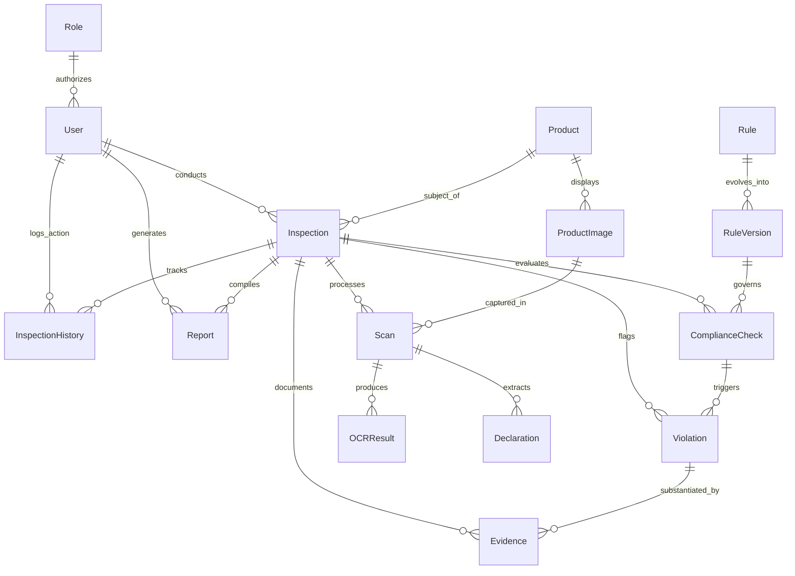
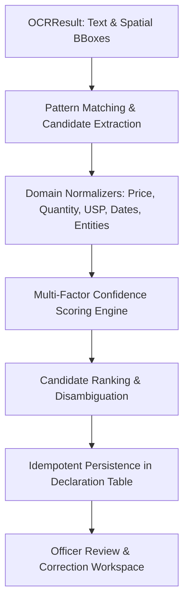
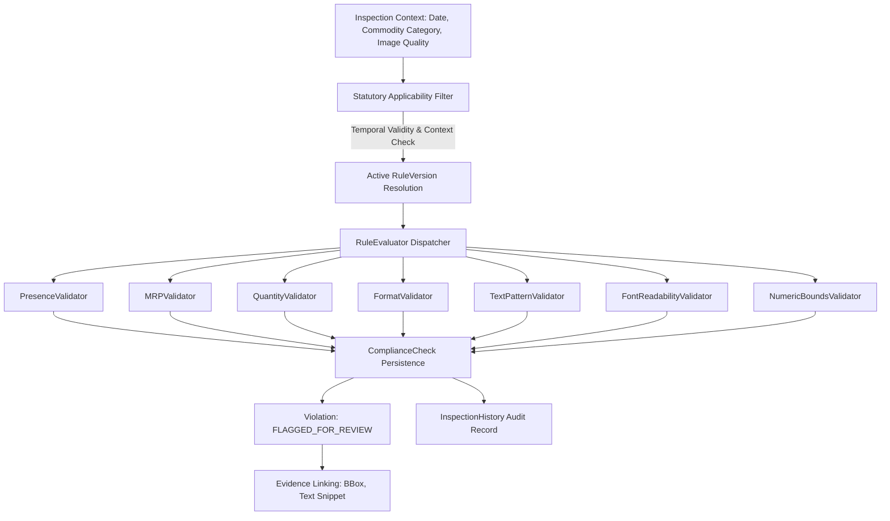
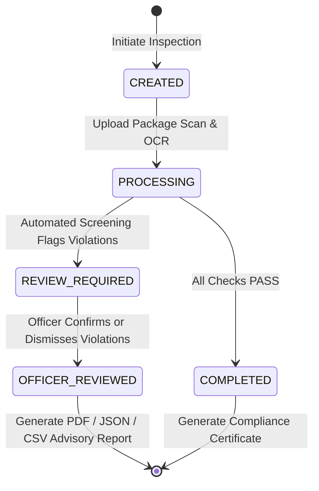

# MetaCheck AI — System Architecture & Data Model Blueprint

## 1. Executive Overview
**MetaCheck AI** is an AI-assisted Legal Metrology compliance inspection platform designed to screen packaged commodity declarations against statutory Indian Legal Metrology regulations—specifically **The Legal Metrology Act, 2009** and **The Legal Metrology (Packaged Commodities) Rules, 2011 (PCR, 2011)**.

> **Statutory Notice**: MetaCheck AI operates strictly as an **AI-assisted screening tool**. Output findings represent advisory screening indications (e.g. *"Potential non-compliance detected"* and *"Manual verification recommended"*). Final legal determinations rest exclusively with authorized Legal Metrology Officers (LMOs).

---

## 2. Complete Phase 2 Relational Data Architecture



---

## 3. Database Entity Specifications

| Table | Entity | Description & Key Attributes |
| :--- | :--- | :--- |
| `roles` | **Role** | Role-Based Access Control (`ADMIN`, `ENFORCEMENT_OFFICER`, `VIEWER`). |
| `users` | **User** | Inspector and analyst profiles with password hashes and active status flags. |
| `products` | **Product** | Packaged commodity master data: Brand, Category, Manufacturer, Packer, Importer, Barcode/GTIN, Country of Origin. |
| `product_images` | **ProductImage** | Image references categorized by panel (`FRONT_PDP`, `BACK_DECLARATION`, `SIDE_PANEL`, `BOTTOM_BASE`). |
| `inspections` | **Inspection** | **Central workflow entity**. Tracks field audits with statuses: `CREATED`, `PROCESSING`, `COMPLETED`, `REVIEW_REQUIRED`, `FAILED`. |
| `scans` | **Scan** | Processing execution for a specific panel image. |
| `ocr_results` | **OCRResult** | Multi-engine OCR text outputs with bounding box coordinates and token confidence scores. |
| `declarations` | **Declaration** | Structured extracted attributes (Net Quantity, MRP, USP, Date of Packing, Consumer Care). |
| `rules` | **Rule** | Statutory rule definition grounded in Department of Consumer Affairs publications. |
| `rule_versions` | **RuleVersion** | Temporal statutory versioning enabling regulatory amendments (e.g. PCR 2011 -> 2022 Amendment) without schema changes. |
| `compliance_checks` | **ComplianceCheck** | Automated screening evaluations against specific rule versions (`PASS`, `FAIL`, `REVIEW`, `NOT_APPLICABLE`). |
| `violations` | **Violation** | Flagged potential non-compliances awaiting physical officer verification. |
| `evidences` | **Evidence** | Image crops, OCR bounding boxes, and calculation logs substantiating every finding. |
| `reports` | **Report** | Official advisory inspection dossiers and draft notices (PDF, JSON, CSV). |
| `inspection_histories` | **InspectionHistory** | Immutable audit trail capturing every state change, timestamp, and officer action. |

---

## 4. Key Architectural Principles

### 4.1. Rule vs. RuleVersion Design
Statutory regulations evolve over time (e.g., the introduction of mandatory Unit Sale Price under Rule 6(1)(ea) in the 2021/2022 amendments).
- **`Rule`**: Encapsulates the immutable statutory intent and clause identifier (e.g. `PCR_2011_RULE_6_1_EA`).
- **`RuleVersion`**: Encapsulates the specific parameters, thresholds, effective dates (`active_from` / `active_to`), and gazette references. Inspections reference the exact `RuleVersion` active at the time of commodity packaging.

### 4.2. Inspection as the Central Workflow Entity
The `Inspection` record coordinates all operational workflows:
1. Originates from field capture (`MOBILE_CAMERA`), portal upload (`PORTAL_UPLOAD`), or API integration.
2. Organizes multi-panel label scans (`Scan`).
3. Links to extracted label declarations (`Declaration`) and OCR outputs (`OCRResult`).
4. Aggregates automated rule screening (`ComplianceCheck`).
5. Tracks officer verification and audit logs (`InspectionHistory`).

### 4.3. Full Evidence Traceability
Every flagged potential non-compliance (`Violation`) is linked to an underlying `ComplianceCheck` and one or more `Evidence` records. This ensures that every advisory flag is supported by high-resolution image crops, spatial bounding boxes, and OCR text snippets for court-admissible audit trails.

---

## 5. Core API Endpoints (Version 1 — `/api/v1`)

| Module | Route | Methods | Description |
| :--- | :--- | :--- | :--- |
| **Health** | `/api/health` | `GET` | Live system and database connectivity health probe. |
| **Products** | `/api/v1/products` | `GET`, `POST` | List commodities (with search & filtering) and create product. |
| | `/api/v1/products/{id}` | `GET`, `PUT`, `DELETE` | Retrieve, update, or remove commodity. |
| | `/api/v1/products/{id}/images` | `POST` | Attach panel image references. |
| **Inspections** | `/api/v1/inspections` | `GET`, `POST` | List inspections (with status/date filters) and initiate audit. |
| | `/api/v1/inspections/{id}` | `GET` | Get full inspection dossier with checks and scans. |
| | `/api/v1/inspections/{id}/status`| `PATCH` | Transition inspection status with automatic audit log insertion. |
| | `/api/v1/inspections/{id}/history`| `GET` | Retrieve immutable audit trail. |
| | `/api/v1/inspections/{id}/scans` | `POST` | Attach scan records. |
| **Rules** | `/api/v1/rules` | `GET`, `POST` | List statutory rules and register new clauses. |
| | `/api/v1/rules/{id}` | `GET`, `PUT` | Get rule details with version history. |
| | `/api/v1/rules/{id}/versions` | `GET`, `POST` | Retrieve and publish versioned rule specifications. |
| **Violations** | `/api/v1/violations` | `GET`, `POST` | List flagged infractions and create violation records. |
| | `/api/v1/violations/{id}` | `GET`, `PATCH` | View violation dossier and update officer verification status. |
| | `/api/v1/violations/{id}/evidences`| `POST` | Attach cropped bounding-box evidence. |
| **Reports** | `/api/v1/reports` | `GET`, `POST` | List and create audit reports. |
| | `/api/v1/reports/{id}` | `GET` | Retrieve report metadata. |
| **Users & Roles**| `/api/v1/roles` | `GET`, `POST` | List and create RBAC roles. |
| | `/api/v1/users` | `GET`, `POST` | List officers and register officer accounts (safe passwords). |
| | `/api/v1/users/{id}` | `GET` | Get officer profile. |

---

## 6. Database Migration Workflow (Alembic)

Database schema evolution is strictly managed via Alembic:
```bash
# Generate a new migration after model changes
alembic revision --autogenerate -m "description_of_change"

# Apply migrations to live PostgreSQL database
alembic upgrade head

# Rollback one migration version
alembic downgrade -1

# Generate SQL script without connecting to DB
alembic upgrade head --sql
```

---

## 7. Phase 3: OCR & Computer Vision Subsystem

### 7.1. Vision Pipeline Architecture
1. **Structural Validation (`validate_image_file`)**:
   - Magic byte MIME verification (`image/png`, `image/jpeg`, `image/webp`, `image/tiff`, `image/bmp`).
   - Dimension boundaries ($50\text{px} \le \text{dim} \le 8192\text{px}$) and $15\text{MB}$ file size envelope.
2. **Quality Analytics (`assess_image_quality`)**:
   - Discrete 2D Laplacian operator variance for edge sharpness and blur detection.
   - Mean luminance and contrast standard deviation dynamic range calculation.
   - Non-blocking statutory advisory warnings.
3. **Preprocessing Pipeline (`preprocess_image`)**:
   - EXIF orientation auto-rotation (`exif_transpose`).
   - Grayscale conversion with alpha-channel compositing.
   - Auto-contrast normalization and linear contrast stretching.
   - Edge sharpening via Unsharp Masking ($r=1.5, \%=150, t=3$).
   - Optional Otsu binarization.
4. **Multi-Engine OCR Extraction (`BaseOCRProvider`)**:
   - `MockOCRProvider`: High-accuracy synthetic declaration provider for automated testing and CI/CD.
   - `TesseractOCRProvider`: Non-blocking async execution over system Tesseract binaries.
   - `PaddleOCRProvider`: PP-OCRv4 multi-lingual text extraction with 4-point polygon to axis-aligned bounding box converter.
   - `OCRProviderFactory`: Dynamic provider resolution with auto-fallback.
5. **Storage & Scan Management (`LocalStorageProvider`, `ScanProcessorService`)**:
   - Safe path traversal resolution preventing directory escapes.
   - Automatic `Scan` lifecycle orchestration (`PENDING` $\to$ `PROCESSING` $\to$ `COMPLETED` / `FAILED`).
   - Idempotent `OCRResult` persistence with detailed token-level spatial coordinates.

### 7.2. OCR API Endpoints
| Endpoint | Method | Description |
| :--- | :--- | :--- |
| `/api/v1/scans/upload-and-process` | `POST` | Upload label image, create entity hierarchy, and execute OCR extraction. |
| `/api/v1/scans/{scan_id}/process-ocr` | `POST` | Trigger OCR extraction pipeline for an existing scan record. |
| `/api/v1/scans/{scan_id}/ocr` | `GET` | Retrieve extracted OCR text, confidence scores, and bounding boxes. |
| `/api/v1/images/analyze-quality` | `POST` | Immediate pre-flight computer vision quality evaluation. |

---

## 8. Phase 4: Declaration Extraction & Normalization Subsystem

### 8.1. Architecture & Scope
The Phase 4 extraction pipeline transforms raw, noisy OCR text and spatial bounding coordinates into standardized, structured Legal Metrology declarations without performing legal compliance scoring (which is strictly decoupled into Phase 5).



### 8.2. Supported 13 Legal Metrology Declaration Types
1. `PRODUCT_NAME`: Brand name, commodity identity, and proprietary designations.
2. `GENERIC_NAME`: Common/generic name of the commodity per Rule 6(1)(b).
3. `NET_QUANTITY`: Metric mass/volume/length/count with standard unit normalization (`g`, `kg`, `ml`, `L`, `m`, `N`).
4. `MRP`: Maximum Retail Price in INR with tax inclusivity normalization.
5. `UNIT_SALE_PRICE`: Price per unit weight or measure per Rule 6(1)(ea).
6. `DATE_OF_MANUFACTURE`: Month and year of manufacture formatted as `MM/YYYY` or `DD/MM/YYYY`.
7. `DATE_OF_PACKING`: Month and year of pre-packaging / import formatted as `MM/YYYY` or `DD/MM/YYYY`.
8. `MANUFACTURER_DETAILS`: Name and complete address of the manufacturer.
9. `PACKER_DETAILS`: Name and complete address of the third-party packer.
10. `IMPORTER_DETAILS`: Name and address of the importer with import registration details.
11. `COUNTRY_OF_ORIGIN`: Standardized country of manufacture for domestic and imported goods.
12. `CONSUMER_CARE`: Multi-modal contact details including toll-free helpline, phone, email, and web.
13. `OTHER`: Batch numbers, statutory warnings, and other packaging marks.

### 8.3. Multi-Factor Confidence Scoring Algorithm
Confidence score $C \in [0.0, 1.0]$ is computed as:
$$C = 0.30 \cdot C_{\text{OCR}} + 0.30 \cdot C_{\text{Keyword}} + 0.25 \cdot C_{\text{Format}} + 0.15 \cdot C_{\text{Context}} - D_{\text{Ambiguity}}$$

Where:
- $C_{\text{OCR}}$: Raw optical character recognition confidence from the underlying engine.
- $C_{\text{Keyword}}$: Proximity and exactness of statutory label anchor keywords (e.g. `MRP Incl. of all taxes`, `Net Wt.`).
- $C_{\text{Format}}$: Structural compliance of the extracted token (e.g. valid ISO date, valid metric symbol, standard Indian phone/email format).
- $C_{\text{Context}}$: Panel contextual affinity (e.g. PDP vs. Back declaration panel).
- $D_{\text{Ambiguity}}$: Penalty deduction ($0.15$) applied when multiple competing candidates of high confidence are detected.

### 8.4. Declaration Extraction APIs
| Endpoint | Method | Description |
| :--- | :--- | :--- |
| `/api/v1/scans/{scan_id}/extract-declarations` | `POST` | Trigger structured Legal Metrology extraction and normalization from OCR output. |
| `/api/v1/scans/{scan_id}/declarations` | `GET` | Retrieve all structured declarations for a scan with confidence ratings and bounding boxes. |
| `/api/v1/declarations/{declaration_id}` | `GET` | Retrieve single declaration record. |
| `/api/v1/declarations/{declaration_id}` | `PATCH` | Manual officer correction and verification without destroying raw OCR evidence. |

---

## 9. Phase 5 & 5.1: Legal Metrology Rule Engine Subsystem

### 9.1. Statutory Accuracy Baseline & Authoritative Source
The MetaCheck AI Rule Engine evaluates extracted packaged commodity declarations against statutory rules published by the **Department of Consumer Affairs, Ministry of Consumer Affairs, Food & Public Distribution, Government of India**.

### 9.2. Rule Engine Architecture


### 9.3. Key Statutory Provisions Verified in Phase 5.1
1. **Rule 6(1)(a)**: Name & complete address of manufacturer / packer / importer.
2. **Rule 6(1)(b)**: Generic or common name of commodity on Principal Display Panel.
3. **Rule 6(1)(c) & Rule 11**: Net quantity in standard metric units or count/number per Second Schedule.
4. **Rule 6(1)(d)**: Temporal versioning distinguishing pre-Dec 2022 baseline from Dec 2022+ Date of Manufacture mandates per G.S.R. 779(E).
5. **Rule 6(1)(e)**: Maximum Retail Price (MRP) with tax-inclusive clauses across pre-GST and post-GST / 2021 versions.
6. **Rule 6(1)(ea) & Rule 6(11)**: Unit Sale Price (USP) enforced strictly w.e.f. **1st December 2022** (G.S.R. 779(E) & 758(E)).
7. **Rule 6(1)(g)**: Consumer Care details with multimodal contact channels (phone, email, postal address).
8. **Rule 6(1)(h) & Rule 6(10)**: Strict distinction between imported physical package country of origin (mandatory for imported commodities) and marketplace e-commerce filter requirements (Rule 6(10) w.e.f. 1st July 2026, never applied to physical packaging).
9. **Rules 7 & 8, Table I**: Font height ratios on uncalibrated digital imagery yield advisory `REVIEW` states rather than fabricated millimeter assertions.

### 9.4. Official Statutory Rule Baseline Table

| Rule Code | Exact Provision | Source | Effective From | Effective To | Verification Status |
| :--- | :--- | :--- | :--- | :--- | :--- |
| `PCR_2011_RULE_6_1_A` | Name & complete address of manufacturer / packer / importer | Legal Metrology (Packaged Commodities) Rules, 2011 (GSR 202(E) & GSR 592(E)) | 2011-04-01 | Present | `VERIFIED_OFFICIAL` |
| `PCR_2011_RULE_6_1_B` | Common or generic names of commodity on Principal Display Panel | Legal Metrology (Packaged Commodities) Rules, 2011 (GSR 202(E)) | 2011-04-01 | Present | `VERIFIED_OFFICIAL` |
| `PCR_2011_RULE_6_1_C` | Net quantity in standard metric units or count/number per Second Schedule | Legal Metrology (Packaged Commodities) Rules, 2011 (GSR 202(E) & Rule 11) | 2011-04-01 | Present | `VERIFIED_OFFICIAL` |
| `PCR_2011_RULE_6_1_D` (v1.0) | Month & year of manufacture or pre-packed or imported (Historical) | Legal Metrology (Packaged Commodities) Rules, 2011 (GSR 202(E)) | 2011-04-01 | 2022-11-30 | `VERIFIED_OFFICIAL` |
| `PCR_2011_RULE_6_1_D` (v2.0) | Month & year of manufacture (or import for imported goods) | Legal Metrology (Packaged Commodities) (Amendment) Rules, 2021 (GSR 779(E)) | 2022-12-01 | Present | `VERIFIED_OFFICIAL` |
| `PCR_2011_RULE_6_1_E` (v1.0) | Max. retail price Rs. ... inclusive of all taxes (Pre-GST wording) | Legal Metrology (Packaged Commodities) Rules, 2011 (GSR 202(E)) | 2011-04-01 | 2017-06-30 | `VERIFIED_OFFICIAL` |
| `PCR_2011_RULE_6_1_E` (v2.0) | Maximum Retail Price Rs./₹ ... inclusive of all taxes or MRP Rs./₹ ... | Legal Metrology (Packaged Commodities) Amendment Rules, 2017 & 2021 (GSR 592(E) & 779(E)) | 2017-07-01 | Present | `VERIFIED_OFFICIAL` |
| `PCR_2021_RULE_6_1_EA` | Unit Sale Price in Rs. per g/ml, per kg/L, or per number/piece per Rule 6(11) | Legal Metrology (Packaged Commodities) (Amendment) Rules, 2021 (GSR 779(E) & GSR 758(E)) | 2022-12-01 | Present | `VERIFIED_OFFICIAL` |
| `PCR_2011_RULE_6_1_G` | Consumer care telephone number, email, and grievance address | Legal Metrology (Packaged Commodities) Rules, 2011 (GSR 202(E)) | 2011-04-01 | Present | `VERIFIED_OFFICIAL` |
| `PCR_2011_RULE_6_1_H` | Country of origin on imported packaged commodities | Legal Metrology (Packaged Commodities) (Amendment) Rules, 2017 (GSR 592(E)) | 2017-07-01 | Present | `VERIFIED_OFFICIAL` |
| `PCR_2026_RULE_6_10A_ECOM` (v1.0)| Country of origin searchable/sortable filter for imported products on e-commerce (G.S.R. 128(E) dated 13 Feb 2026) | Legal Metrology (Packaged Commodities) Amendment Rules, 2026 | 2026-07-01 | 2027-07-01 | `VERIFIED_OFFICIAL` |
| `PCR_2026_RULE_6_10A_ECOM` (v2.0)| Country of origin searchable and sortable filter for imported products on e-commerce (G.S.R. 312(E) dated 27 Apr 2026) | Legal Metrology (Packaged Commodities) Second Amendment Rules, 2026 | 2027-07-01 | Present | `VERIFIED_OFFICIAL` |
| `PCR_2011_RULE_7_8` | Minimum font and numeral height ratio per Table I (Uncalibrated photo review) | Legal Metrology (Packaged Commodities) Rules, 2011 (GSR 202(E)) | 2011-04-01 | Present | `VERIFIED_OFFICIAL` |

---

## 10. Phase 6: Inspection Workflow, Violation Review, Dashboard & Reports

### 10.1. End-to-End Inspection Lifecycle


### 10.2. Role-Based Access Control (RBAC) Matrix
| Action / Endpoint | `ADMIN` | `ENFORCEMENT_OFFICER` | `VIEWER` (Read-Only) |
| :--- | :---: | :---: | :---: |
| View Dashboard & Analytics | Allowed | Allowed | Allowed |
| List & View Inspection Dossiers | Allowed | Allowed | Allowed |
| Download Advisory Reports (PDF/JSON/CSV) | Allowed | Allowed | Allowed |
| Update Inspection Status (`PATCH /status`) | Allowed | Allowed | **403 Forbidden** |
| Review Flagged Violations (`PATCH /review`)| Allowed | Allowed | **403 Forbidden** |
| Generate Advisory Reports | Allowed | Allowed | Allowed |
| User & System Configuration | Allowed | **403 Forbidden** | **403 Forbidden** |

### 10.3. Violation Review Subsystem
Every potential non-compliance flagged by the automated Legal Metrology rule engine is initialized with `status = FLAGGED_FOR_REVIEW`.
Enforcement officers review the evidence and transition the finding to either:
1. `OFFICER_CONFIRMED`: Officer verifies non-compliance under physical inspection with mandatory justification comment.
2. `DISMISSED`: Finding dismissed due to valid lighting, physical label verification, or exemption with explanation.

Submitting reviews automatically:
- Attaches `reviewed_by` and `reviewed_at` timestamps.
- Appends an immutable record to `InspectionHistory`.
- Evaluates the overall inspection status: transitions to `OFFICER_REVIEWED` when all infractions have been adjudicated.

### 10.4. Live Database Operational Dashboard
The `/api/v1/dashboard/summary` endpoint provides real-time aggregations queried directly from PostgreSQL:
- **Core Counters**: Total inspections, today's screenings, review required count, officer reviewed count, flagged vs. confirmed violations.
- **Compliance Rate**: Percentage of fully compliant screenings against total inspections.
- **Category Breakdown**: Aggregations across registered product categories.
- **Severity Distribution**: Violations categorized by statutory risk tier (`CRITICAL`, `MAJOR`, `MINOR`, `ADVISORY`).
- **Top Violated Rules**: Most frequently violated PCR 2011 clauses.
- **7-Day Trend**: Daily volume and compliance trends.
- **Workload Summary**: Active inspector assignments.

### 10.5. Report Generation Subsystem
The report engine generates immutable, digitally verifiable advisory dossiers in three formats:
1. **PDF (`ReportFormatEnum.PDF`)**: Custom pure-Python PDF 1.4 vector generator with MetaCheck AI branding, product metadata, statutory findings table, officer review comments, and Department of Consumer Affairs legal disclaimers.
2. **JSON (`ReportFormatEnum.JSON`)**: Full machine-readable inspection dossier including raw OCR, normalized values, bounding boxes, and audit history.
3. **CSV (`ReportFormatEnum.CSV`)**: Tabular export formatted for statistical analysis, compounding records, and department analytics.

